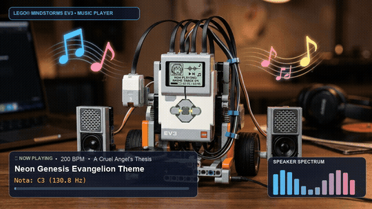

*[Leia em Português](README.md)*

# LEGO EV3 Anime Music Player

A Python anime music player for the LEGO Mindstorms EV3 robot built using the **Pybricks** library on the **ev3dev** operating system.

On each run, the robot randomly chooses a soundtrack from the song list and synthesizes the chiptune melody through the EV3 brick's internal speaker.

---

## Demonstration



> 🎥 **Video with audio:** Watch the [recorded video with chiptune audio (MP4)](assets/robot_playing.mp4) played on the robot.

---

## Included Songs

| Song | Anime | Tempo (BPM) | Note Format |
| :--- | :--- | :---: | :--- |
| **A Cruel Angel's Thesis** | Neon Genesis Evangelion | 200 BPM | Pitch/Octave and duration fraction (e.g. `C3/3`, `D#3/3`, `R4/8`) |
| **Bluebird** | Naruto Shippuden | 180 BPM | Pitch/Octave and duration fraction (e.g. `C#4/4`, `F#4/4`, `A4/2`) |
| **We Are!** | One Piece | 192 BPM | Pitch/Octave and duration fraction (e.g. `A#4/6`, `D#5/2`, `F5/1`) |

---

## How It Works

The script [`musicas.py`](musicas.py) organizes all tracks inside a declarative `MUSICAS` list, where each entry contains:
* `nome`: Title and anime series.
* `tempo`: Song speed in beats per minute (BPM).
* `notas`: List of musical notes and rests using Pybricks standard notation (`[note][octave]/[duration]`).

Track selection is handled with `random.choice(MUSICAS)`. The script also provides an automatic fallback for desktop testing (PC/Mac/Linux) without requiring physical EV3 hardware libraries.

---

## Prerequisites

* LEGO Mindstorms EV3 intelligent brick.
* MicroSD card with [ev3dev](https://www.ev3dev.org/) installed.
* Python environment configured with the [Pybricks](https://pybricks.com/) library.

---

## How to Run

### On the LEGO EV3 Brick (ev3dev)

1. Connect to your EV3 via SSH or using the **LEGO MINDSTORMS EV3 MicroPython** extension in VS Code.
2. Transfer `musicas.py` to your robot's project directory.
3. Grant execution permissions (if running via terminal):
   ```bash
   chmod +x musicas.py
   ```
4. Run the script:
   ```bash
   ./musicas.py
   ```
   *Or launch it directly from the EV3 File Browser on the brick's LCD display.*

### Local Test on Computer (Simulation Mode)

To test the logic and random selection before deploying to the robot:
```bash
python3 musicas.py
```

---

## License

Distributed under the [MIT License](LICENSE). See `LICENSE` for more information.
